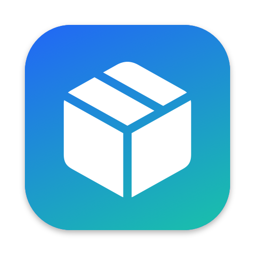
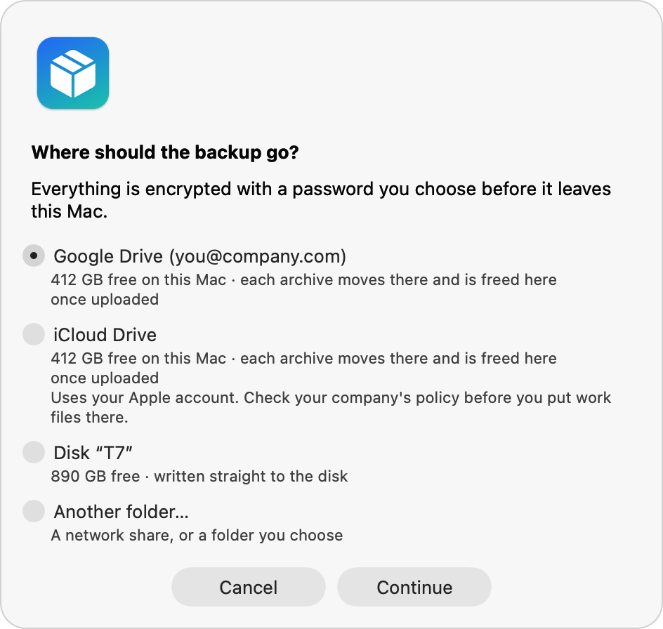
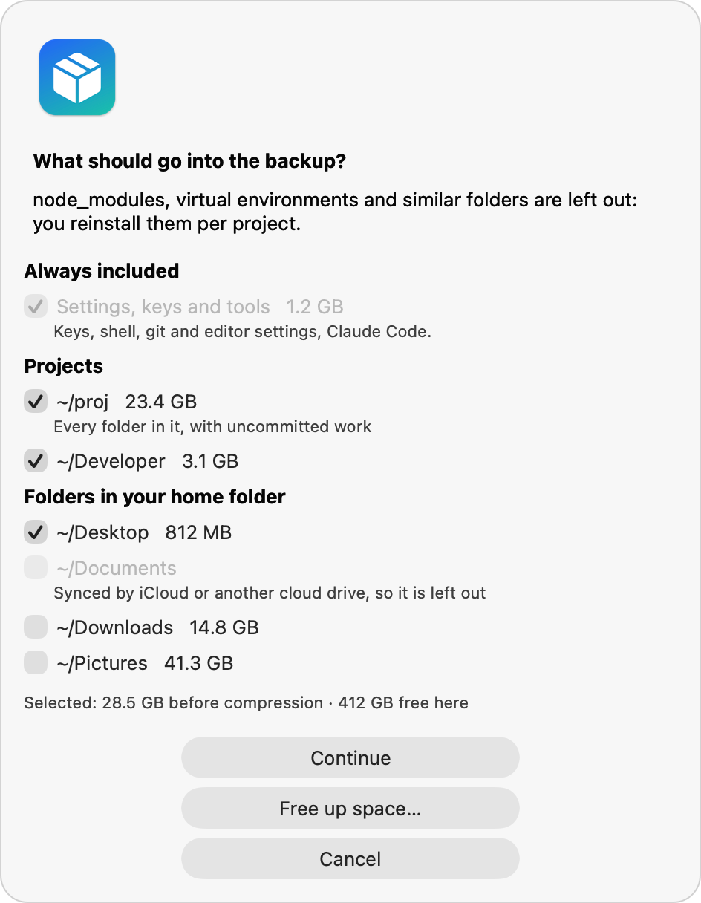
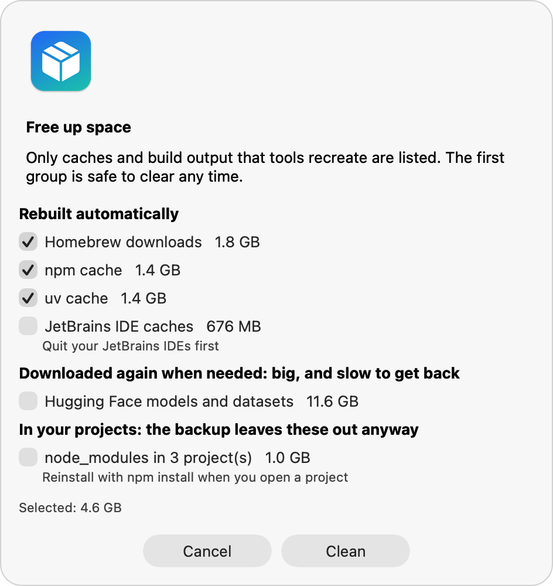

<p align="center"></p>

<h1 align="center">Mac Migrate</h1>

<p align="center">Move your developer setup to a new Mac when Migration Assistant isn't an option.<br>
<a href="https://nikolavas.github.io/mac-migrate/">Website</a> · <a href="#get-started">Get started</a> · <a href="CHANGELOG.md">Changelog</a></p>

<p align="center"><a href="https://github.com/nikolavas/mac-migrate/actions/workflows/test.yml"></a></p>

This is common on company Macs managed by Jamf, Intune, Kandji or similar. IT enrolls the new Mac from scratch, Migration Assistant is blocked or would drag along old management profiles, and your account may get a new username, for example `firstname.lastname` instead of `firstnamelastname`.

Mac Migrate packs your settings, keys and projects into encrypted archives, puts them on Google Drive, iCloud Drive, OneDrive, Dropbox or a disk, and unpacks them on the new Mac with your old paths rewritten. It also builds a software package that reinstalls your apps and tools, and can free up space on a full disk first.

It runs as your normal user: no admin rights, nothing to install, no network pairing between the two Macs. It uses only what ships with macOS, and the app is built on your Mac from its source, so Gatekeeper has nothing to block.

<p align="center">
<picture><source media="(prefers-color-scheme: dark)" srcset="site/screenshots/destination-dark.png"></picture>
<picture><source media="(prefers-color-scheme: dark)" srcset="site/screenshots/include-dark.png"></picture>
</p>

## What it moves

| Moved | Not moved, and why |
|---|---|
| SSH and GPG keys, cloud CLI configs (`.ssh`, `.gnupg`, `.aws`, `.azure`, `.kube`) | Apps: the software package reinstalls them (see below) |
| Shell, git, editor and terminal config (`.zshrc`, `.gitconfig`, `.config/nvim`, …) | `~/Library`: caches and app data that sync again or rebuild |
| Claude Code settings, skills and memory (`.claude`, `.claude.json`) | Keychain items: CLI tokens stored there need a fresh login |
| Every folder in your project folders (`~/proj`, `~/code`, `~/Developer`, …), including uncommitted work, stashes and local branches | `node_modules`, `.venv`, `.next`, `.terraform` and similar: reinstall per project |
| Desktop and Documents, unless iCloud already syncs them, and any other folder you pick | Browser profiles: use your browser's sync |

Before it packs anything, it writes an inventory to `~/.mac-migration/`: every git repo with its remote and any unpushed or uncommitted work, your apps, VS Code extensions and global npm/pipx/uv tools. Repos outside the backed-up folders are listed separately, so nothing is left behind by surprise.

## Get started

### With the app

On the old Mac, download Mac Migrate and build the app. It takes a few seconds and lands in `~/Applications`:

```bash
git clone https://github.com/nikolavas/mac-migrate.git
cd mac-migrate
./make-app.sh --install
```

Then choose **Back up this Mac**. The app asks where the backup goes, what goes in (with sizes) and for a password, then shows the progress. You can stop it at any time and start it again later: it continues where it stopped. Save the password in your password manager: without it the archives can't be opened.

When it's done, it tells you the exact command for the new Mac.

### In Terminal

Everything the app does works in Terminal too:

```bash
./backup.sh --list-places                      # cloud drives and disks found on this Mac
./backup.sh --plan --to "$HOME/Library/CloudStorage/GoogleDrive-you@company.com/My Drive"
./backup.sh --to "$HOME/Library/CloudStorage/GoogleDrive-you@company.com/My Drive"
```

Without `--to`, the archives go to `~/mac-migration-archives` and you copy them yourself, as in earlier versions.

## Where the backup can go

| Destination | How it works |
|---|---|
| **Google Drive, OneDrive, Dropbox** (through their desktop apps) | Each archive is packed on this Mac, moved into the cloud folder, and freed here once it has uploaded. The next archive then has room, so a backup larger than your free space still fits. The backup only reports done when everything has uploaded. |
| **iCloud Drive** | The same, as long as Optimize Mac Storage is on. It uses your personal Apple account, so check your company's policy first. |
| **External disk** | The archives are written straight to the disk, so this Mac needs no free space. On a FAT32 disk they are split into 3.9 GB parts. exFAT or APFS avoids that. |
| **Any other folder** | A network share, or a folder you copy yourself. |

Company shared drives aren't offered: the whole team can see them. Pick one with **Another folder…** if you really want to.

If Google Drive is paused, offline or out of space, nothing uploads. After 10 minutes the backup stops and tells you why, and it continues where it stopped when you start it again.

## On the new Mac

Sign in to the cloud drive with the backup (or connect the disk), then download Mac Migrate with `curl` and restore. You don't need `git`, which isn't installed on a fresh Mac yet:

```bash
curl -fsSL https://github.com/nikolavas/mac-migrate/archive/refs/tags/v2.0.0.tar.gz | tar xz
/bin/bash mac-migrate-2.0.0/restore.sh --from "$HOME/Library/CloudStorage/GoogleDrive-you@company.com/My Drive"
```

`--from` finds the backup in the folder you give or a few levels below it. You can also run the `restore.sh` that sits next to the archives, which the backup's last screen shows, or build the app on the new Mac with `/bin/bash mac-migrate-2.0.0/make-app.sh --install` and choose **Restore on this Mac**.

Close Claude Code first if you use it: it rewrites `~/.claude.json` while it runs.

Before it restores anything, the restore checks the backup's signature and every file's checksum. It shows what it is going to do with `--plan`, and checks the whole backup without restoring with `--verify` (add `--deep` to also decrypt every archive).

## Free up space

A full disk is the usual reason a backup can't start. **Free up space** in the app, or `./cleanup.sh` in Terminal, lists caches and build output that tools recreate by themselves, with their sizes:

- **Rebuilt automatically**, selected by default: Homebrew downloads, npm, pnpm, Yarn, pip and uv caches, the Go build cache, Xcode DerivedData, JetBrains caches, logs.
- **Downloaded again when needed**, opt-in: Gradle and Maven repositories, Go modules, Cargo, Hugging Face models, Playwright and Puppeteer browsers, other apps' caches.
- **In your projects**, opt-in: `node_modules`, virtual environments and build output. The backup leaves these out anyway.

It uses each tool's own clean command when there is one. It never follows a symlink, never touches anything outside your home folder, and skips caches of apps that are running. List folders it should never touch in `CLEANUP_KEEP` in the configuration.

```bash
./cleanup.sh                          # shows what can be freed, then asks
./cleanup.sh --clean npm uv --dry-run # what would be deleted
```

<p align="center"><picture><source media="(prefers-color-scheme: dark)" srcset="site/screenshots/cleanup-dark.png"></picture></p>

## Software on the new Mac

The backup also writes `new-mac-setup/` next to the archives: a `Brewfile`, a `setup.sh` and a `README.md` that lists what is in it. You can run it on the new Mac before the restore, so apps install while the archives download:

```bash
/bin/bash new-mac-setup/setup.sh
```

It installs the Xcode Command Line Tools and Homebrew if they are missing (Homebrew needs an administrator password once), then everything in the Brewfile, your Node.js version through nvm with your global npm packages, your uv and pipx tools, and Claude Code. App Store apps need you signed in to the App Store app. The script is safe to run again. After a restore, the app's **Install apps and tools** button opens it in Terminal.

How the Brewfile is built:

- Your Homebrew taps, formulae, casks and VS Code extensions, from `brew bundle dump`. Deprecated or disabled packages get a comment, or are swapped for their replacement.
- Every other app in `/Applications` and `~/Applications` is matched to a Homebrew cask by app name, by bundle ID, or by name without a version number. A discontinued cask is replaced by its successor, for example the Codex app by the ChatGPT app.
- App Store apps become `mas` lines with their store ID.
- Apple's own apps, background helpers and IDEs that JetBrains Toolbox manages are left out.

Apps your company installs, such as Okta Verify, the VPN client or Microsoft 365, shouldn't be installed a second time through Homebrew. There is no reliable way to tell them apart from apps you installed yourself, so list them in `SETUP_SKIP_APPS` in the configuration. They then appear in the package README under "From your company's self-service portal". Apps without a matching cask are listed there too, to install by hand.

To build the package on its own, without a backup: `./make-setup.sh ~/Desktop/new-mac-setup`.

## Adding a folder later

Forgot a folder, or cleaned up Downloads first? Add it to a backup at any time, also after it finished: **Add folders…** in the app, or

```bash
./backup.sh --to "<same destination>" --add Downloads
```

Each added folder becomes one extra archive (`extra-downloads.tar.gz.enc`), using the same password. Folders already in the backup are skipped. Run the restore again on the new Mac: it restores only what it hasn't restored yet.

## Configuration

Copy `config.example.sh` to `~/.mac-migration/config.sh` and change what you need: the destination, archive and part size, which settings, personal folders and project folders to include, which folder names to skip, which company-managed apps to leave out of the software package, and which caches cleanup never touches. A `config.sh` next to the scripts still works. Choices made in the app take precedence.

## How it works

- **Batches:** each project folder goes whole into one archive, and archives are filled up to about 8 GB of source data. This keeps single uploads manageable and lets the backup run on a nearly full disk.
- **Encryption:** each archive is a gzip'd tar stream encrypted with AES-256-CBC and a key derived from your password (PBKDF2, 200,000 iterations, SHA-256), using the `/usr/bin/openssl` that ships with macOS. The password reaches openssl through a file descriptor, so it never appears in a process list or on disk, and only in an environment variable if you set `MIG_PASS` yourself.
- **Integrity:** `MANIFEST.txt` lists every archive part with its size and SHA-256, and is signed with an HMAC-SHA256 whose key is also derived from your password. The restore refuses a backup whose manifest was changed, and an archive whose checksum doesn't match. A separate `password-check.enc` tells a wrong password apart from tampering. Each archive is also read back right after it is packed.
- **Parts:** where a destination limits file sizes (FAT32, Box), archives are split into parts while they are written, in the same pass that hashes them.
- **Relative paths:** archives store paths relative to your home folder, so they unpack under any username. After unpacking, the restore replaces the old home path in shell, git, SSH, cloud CLI and Claude Code config files. Only whole paths match, so moving from `/Users/nikola` to `/Users/nikola.vasilev` works, also when you run the restore again. It also renames Claude Code's per-project folders, which are named after the project path.
- **Nothing is overwritten silently:** settings and project folders that already exist on the new Mac are moved to `~/.mac-migration-restore/replaced-<timestamp>/` before the restored copy goes in. Top-level folders such as Downloads, Desktop or Pictures are merged instead: what you already have stays, and only files with the same name are moved aside. Bundles such as a Photos library, a Keynote file or an app are never merged: the restored one replaces the existing one, which is moved aside whole.
- **Cloud placeholders:** Desktop and Documents are skipped when iCloud syncs them, or when they hold files that exist only in the cloud. Reading such a placeholder makes macOS download the file first.
- **Privacy permissions:** macOS asks before Terminal or the app may read Desktop, Documents and Downloads. The backup asks before it starts and stops if access is denied, instead of producing near-empty archives.
- **Long runs:** the Mac is kept awake while it works, one run at a time is allowed, and every run writes a log to `~/.mac-migration/logs`. Stopping is always safe: finished archives are kept and half-written ones removed.
- **Backups made by version 1** still restore. They aren't signed, so the restore asks first (`--allow-unsigned` in Terminal).

## Troubleshooting

- **The backup seems stuck.** Watch the progress: it shows the speed and the time left. A large folder with many small files (a `.git` with years of history, for example) is slower than its size suggests. When it waits for an upload, it says so.
- **"Nothing has uploaded to Google Drive for 10 minutes".** Open Google Drive's menu: it may be paused, signed out, offline or out of space. Fix that and start the backup again.
- **"Google Drive keeps the file on this Mac after uploading it".** Drive is set to mirror files instead of streaming them, or the folder is marked available offline. Switch to streaming, free up space, or back up to a disk.
- **"macOS doesn't let Mac Migrate read ~/Desktop".** Open System Settings > Privacy & Security > Files and Folders and turn on Desktop, Documents and Downloads for Mac Migrate (or Terminal), then start again.
- **"tar skipped some files".** The log in the archives folder lists them. Usually these are files you can't read, owned by another user or by root.
- **Google Drive zips my download.** The Drive website zips several files when you download them together, and renames duplicates to `name (1)`. The restore finds renamed parts by their checksum, but unzip first. Easier: install Google Drive for desktop and restore straight from its folder.
- **The restore says "Close Claude Code first".** That happens only while the archive with your Claude Code settings still has to be restored. Quit it, run the restore, then start it again.
- **The app doesn't open on a company Mac.** Security software can block apps that aren't signed by a known developer. Use the Terminal commands: they do the same.

## Alternatives

- [IBM Data Shift](https://github.com/IBM/mac-ibm-migration-tool) is the closest match. It's an open-source macOS app built for Macs managed with Jamf Pro. It copies files, apps and preferences directly between two Macs over Wi-Fi or Thunderbolt. You build a version customized for your organization, and both Macs must be connected at the same time. Mac Migrate is narrower: it focuses on a developer's home folder, works through any cloud drive or disk, and needs no build step beyond `make-app.sh`.
- [Mackup](https://github.com/lra/mackup) backs up application settings to a synced folder. It doesn't move projects and doesn't encrypt. Its symlink mode breaks preferences on macOS 14 and later, so use its copy mode.
- Dotfiles managers such as [chezmoi](https://www.chezmoi.io/) or [yadm](https://yadm.io/), together with a Brewfile, are the better long-term answer for reproducible config. They don't cover projects with unpushed work or one-off secrets, which is where Mac Migrate helps on migration day.
- Microsoft's macOS migration script and Apple Business Manager's MDM migration move a Mac from one MDM to another on the same device. They don't copy data to a new Mac.

## Before you use it at work

Check your company's policy on copying source code and credentials to a cloud drive, even encrypted. Your company's Google Drive or OneDrive is usually fine, a personal iCloud account often isn't. If in doubt, use an encrypted external disk.

## Development

```bash
for t in tests/*.sh; do bash "$t"; done
shellcheck $(git ls-files '*.sh')
```

- `tests/roundtrip.sh` builds a fake home folder, backs it up, restores it under a different username and checks about 60 things, from identical files to rewritten paths and how the software package matches apps to casks.
- `tests/robustness.sh` covers the failure paths: backups made by version 1, tampering and damage, a username that is a prefix of the new one, split archives, renamed downloads, locks, Stop and resume, the password staying out of process lists, and cloud folders through a stub.
- `tests/cleanup.sh` checks that Free up space removes only what was chosen, and never follows a symlink.
- `tests/app.sh` builds the app and runs its self-test against a fake engine.

None of them touch your real home folder. CI runs them on macOS 14, 15 and the latest. `docs/spikes.md` records what was verified about cloud folders and the app before building on it.

The screenshots come from the app itself, with sample data: `./make-app.sh && osascript -l JavaScript app/main.js --screenshots site/screenshots build/icon.png` (add `dark` for the dark ones).

To release, update `VERSION` and `CHANGELOG.md`, then push a tag such as `v2.0.0`: the release workflow runs the tests and publishes the source archive with its checksum.

## License

MIT, see [LICENSE](LICENSE).
